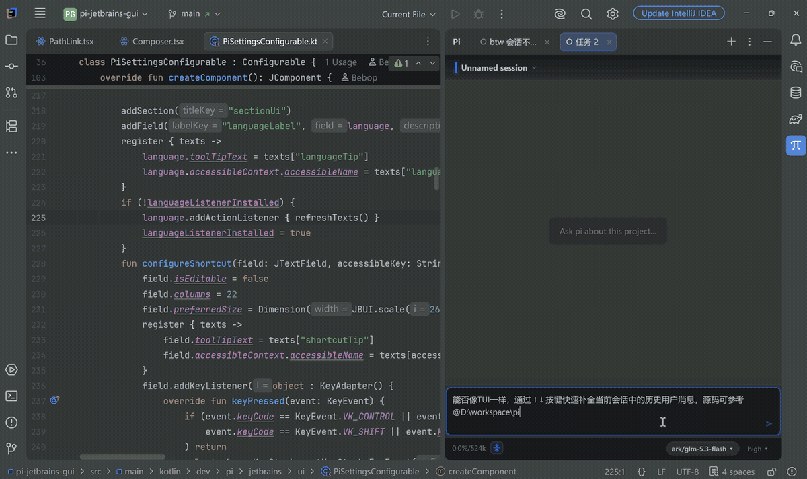
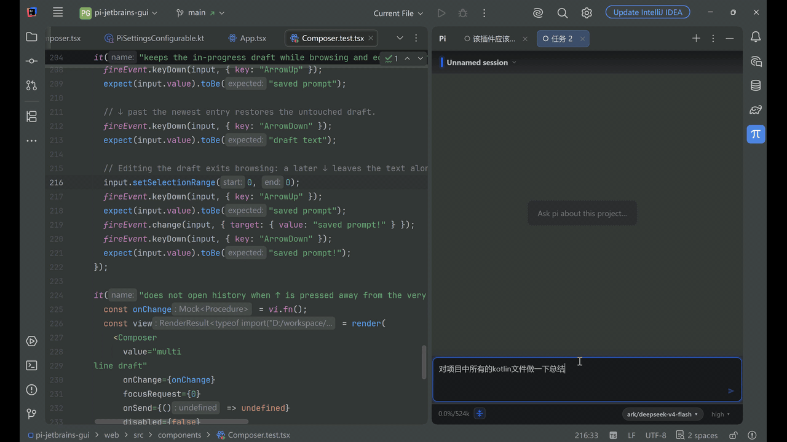
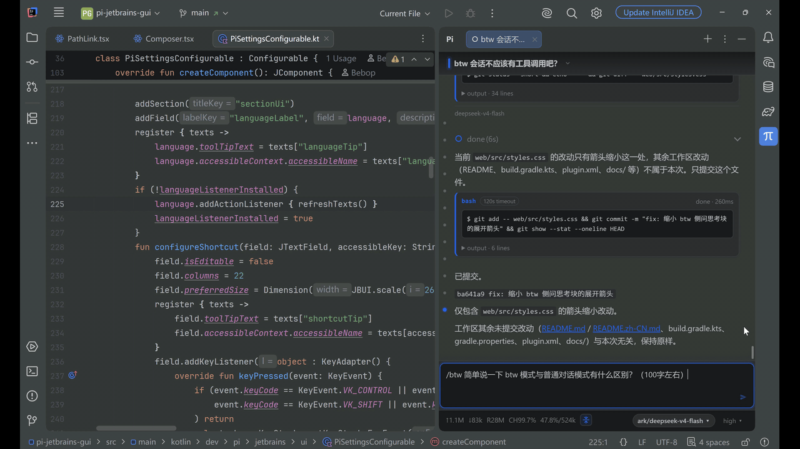

# Pi Coding Agent GUI

[](https://plugins.jetbrains.com/plugin/35678-pi-coding-agent-gui)
[](https://plugins.jetbrains.com/plugin/35678-pi-coding-agent-gui)
[](https://github.com/Cyber0xFE/pi-jetbrains-gui/stargazers)
[](LICENSE)
[](https://plugins.jetbrains.com/plugin/35678-pi-coding-agent-gui)
[](https://nodejs.org)

**Your [pi](https://github.com/earendil-works/pi) coding agent, inside JetBrains IDEs — a real chat panel, not another terminal tab.**

This plugin runs your local `pi --mode rpc` and renders conversations, tool calls, diffs and sessions in the **Pi** tool window. It works in IntelliJ IDEA, PyCharm, WebStorm, GoLand, PhpStorm, CLion, Rider and RubyMine **2024.2+**, and keeps sessions in pi's own `~/.pi` format, so models, extensions and history stay exactly where the CLI put them.

> 🌏 This document is also available in [简体中文 (Chinese)](./README.zh-CN.md). · 📦 [Install from JetBrains Marketplace](https://plugins.jetbrains.com/plugin/35678-pi-coding-agent-gui)



## Why this plugin?

Several plugins put pi into a JetBrains IDE. This one is a full conversation surface with the pi TUI's own interaction model:

| | Pi Coding Agent GUI | [Pi GUI](https://plugins.jetbrains.com/plugin/34238) | [Pi Agent Launcher](https://plugins.jetbrains.com/plugin/31737) | [Pi Terminal Bridge](https://plugins.jetbrains.com/plugin/34738) |
| --- | :---: | :---: | :---: | :---: |
| In-IDE chat panel (no terminal tab) | ✅ | ✅ | — | — |
| Parallel task tabs, one pi process each | ✅ | — | — | — |
| Steering / follow-up queue while pi streams (`Enter` / `Alt+Enter`) | ✅ | — | — | — |
| `/btw` side questions in a dismissible overlay | ✅ | — | — | — |
| Session tree with fork from any user message | ✅ | — | — | ✅ |
| `!` / `!!` shell mode in the composer | ✅ | — | via terminal | via terminal |
| Search inside the transcript (`Ctrl+F`, regex) | ✅ | — | — | — |
| Context meter, manual and auto compaction | ✅ | ✅ | — | — |
| Image paste in the composer | ✅ | ✅ | — | — |
| Editor selection and console output as context | ✅ | ✅ | ✅ | ✅ |
| Diff card jumps to the exact editor line | ✅ | ✅ | — | ✅ |
| Panel actions bound into the IDE keymap | ✅ | — | ✅ | — |
| UI in Chinese and English, switchable in settings | ✅ | ✅ | — | — |

<sub>`—` = not listed in that plugin's own Marketplace description (checked 2026-11). The chat panel ships in English (default) and Simplified Chinese, switchable in `Settings | Tools | Pi`.</sub>

## Features

- Send messages and view streaming replies inside the IDE
- Multiple task tabs at the top, each backed by its own pi process, so different tasks can run concurrently
- Display tool call results such as file reads, edits, and terminal output
- Jump from diffs to the corresponding editor locations
- Save and restore pi sessions
- Automatically attach the current editor selection as context
- Follow the IDE light/dark theme
- Configure the Node.js path, network proxy, log directory, task-completion sound, optional chat background image, and the Pi chat UI language (中文/English) in settings
- Switch models and thinking levels from footer popups, and view context usage and token statistics; the model popup supports search and provider grouping, and can add, edit and delete custom models (written to `~/.pi/agent/models.json` without overwriting existing configuration)
- Create, switch, rename, delete, and fork sessions, and view branches in the session tree
- Browse pi commands with `/` and reference project files with `@`
- Use `/btw <question>` to ask side questions at any time (inspired by Claude Code): the main task is not interrupted, the answer streams in a dismissible overlay, and the Q&A is not written into the main session history; typing `/btw` alone shows the most recent side Q&A. The overlay shows connecting and thinking stages, keeps the reasoning in a collapsed block you can expand, and offers a stop button that keeps the partial answer
- Run shell commands from the input box like the pi TUI: `! <command>` executes it and keeps the output in the LLM context, `!! <command>` keeps the output out of the context; the command and its output render as a terminal-style card once it finishes, with a cancel button while it runs
- Manually compact context, configure auto-compaction, and abort automatic retries
- Support pi extension dialogs, notifications, status text, and status bar widgets
- Jump files, URLs, terminal output, and diff locations directly into the IDE
- Paste images into the input box and send them with your message
- Switch the chat panel between English (default) and Simplified Chinese in settings

## Parallel tasks and queues

Every task tab owns its own `pi` process, so several tasks can run at once and switching tabs never interrupts background work. While pi is streaming you can keep typing: `Enter` queues **steering** (delivered after the current tool call, before the next model call) and `Alt+Enter` queues a **follow-up** (processed after the run ends) — the same semantics as the pi TUI. Queued messages are listed above the composer and can be edited or removed individually.



## Side questions with `/btw`

Ask a question mid-task without interrupting it. `/btw <question>` streams its answer into a dismissible overlay and stays out of the session history; typing `/btw` alone shows the most recent side Q&A.



## Requirements

- Any IntelliJ Platform IDE (IntelliJ IDEA, PyCharm, WebStorm, GoLand, PhpStorm, CLion, Rider, ...) 2024.2 or later (minimum plugin build `242`)
- Java 21 (for building the plugin)
- Node.js `22.19.0` or later
- The pi coding agent installed via any of the following:

  ```bash
  # Official install script (macOS/Linux)
  curl -fsSL https://pi.dev/install.sh | sh

  # Or install globally with npm
  npm install -g @earendil-works/pi-coding-agent
  ```

The plugin looks for pi in the following order: the entry configured in settings, the copy bundled with the plugin, the directory managed by the pi install script (`~/.pi/agent/install`), and the npm global install directory.
Node.js is resolved first from the path configured in settings and the system `PATH`, falling back to the standalone Node bundled with the pi install script (`~/.local/share/pi-node`). If startup fails, fill in an executable Node.js path in settings and verify the pi CLI is installed correctly.

## Building and Running

Run from the project root:

```bash
./gradlew buildPlugin
```

On Windows (PowerShell):

```powershell
.\gradlew.bat buildPlugin
```

To run a development IDE with the plugin:

```bash
./gradlew runIde
```

The plugin ZIP is generated in `build/distributions/`. The Gradle build automatically installs webview dependencies and bundles the React/TypeScript frontend into the plugin resources.

On Windows, a successful local build also queues plugin updates for every detected JetBrains IDE configuration directory (2024.2 or later) under `%APPDATA%/JetBrains/`, including IntelliJ IDEA, PyCharm, WebStorm, GoLand, PhpStorm, CLion, Rider, and the rest of the family. It uses each IDE's built-in update queue, preserves other pending plugins, and does not overwrite JARs held open by a running IDE. Updates are installed the next time you restart the IDE; the build never closes your IDE automatically. Configuration directories without a `%LOCALAPPDATA%/JetBrains/<config-dir-name>/.home` record (an IDE that has never been launched) are skipped with a log message. The `Queued plugin update` message in the build log only means the update was queued, not that a running IDE has already loaded it.

To only build the ZIP without installing: `./gradlew buildPlugin -PinstallLocalPlugin=false`. To specify local configuration directories, pass `-PlocalIdePluginDirs=dir1;dir2` (quote the whole argument in PowerShell); these must be each IDE's `plugins` directory, and a corresponding `%LOCALAPPDATA%/JetBrains/<config-dir-name>/.home` record must exist. Custom cache paths are not supported yet.

## Usage

1. Install the built plugin ZIP in your IDE, or start a development IDE with `runIde`.
2. Open the **Pi** tool window on the right side.
3. Check the Node.js path and log directory in `Settings | Tools | Pi`. If you need a proxy, enter the full address under "Network proxy" (for example `http://127.0.0.1:7890`); the plugin injects both `HTTP_PROXY` and `HTTPS_PROXY` into the Pi subprocess (without affecting the IDE or other applications). Applying proxy changes restarts the Pi processes of already started tabs and restores their sessions, interrupting running tasks; tabs that have not started yet will use the new settings on next launch. Leaving it empty keeps the system proxy environment variables inherited from the IDE.
4. Send messages from the input box, or select text in the editor and send it to Pi via the console context menu.
5. Click **＋** at the top of the Pi tool window to create a new task tab; switching tabs does not interrupt background tasks. Closing a tab stops its process, with a confirmation when a task is running; past sessions can still be restored from the session list. The console "Send to Pi" action sends to the currently selected tab.

The session list supports creating, switching, renaming, deleting, and forking sessions; switching to a session already open in another tab jumps directly to that tab instead of loading it twice. Before deleting the current session, the plugin switches to a new one first, so pi stops writing to the file being deleted; clicking the delete icon on a session row turns it into a red confirm button in place, and only a second click deletes the session — moving the pointer away, changing the filter text, selecting another row, or refreshing the list cancels the pending confirmation. The session tree collapses to one row per user message: click a user message to expand or collapse the assistant, tool result and bookkeeping entries underneath, and hover a user message to use the **fork from here** button (clicking the row itself never forks). The model selector syncs the selected default model to pi's user settings; session-level switching is still controlled by the current session. The model and thinking entries in the footer open small popups above them (click outside or press `Esc` to close); the model popup groups models by provider, supports search and keyboard navigation, shows **Set as default** only on hovered rows, and its **Add model** button opens a model form that appends custom providers/models to `~/.pi/agent/models.json`: for an existing provider, only new models are appended to its `models` list — fields such as `apiKey` and `baseUrl` are never rewritten — and duplicate model ids are rejected. The provider field suggests the providers already in your list while still accepting a new name, and context window / max output tokens accept `k` shortcuts such as `128k` or `8k`. Models that come from `models.json` are treated as custom: hovering such a row reveals a pencil that reopens the same form pre-filled (provider and model ID locked) and rewrites that entry in place, keeping other provider fields and the stored API key unless you type a new one, plus a bin that turns into a red **confirm delete** and needs a second click. After saving or deleting, pi restarts automatically to pick up the change; while pi is streaming the plugin says so and the models load after the next restart.

Press `Ctrl+F` in the session area to open the message search bar. It searches keywords in user messages and assistant replies, and supports toggling case sensitivity, whole-word matching, and regular expressions. `Enter` / `Shift+Enter` jump to the next/previous match, `Esc` or the close button exits search, and the message containing the current match is highlighted.

While pi is streaming a reply, you can keep typing in the input box: `Enter` queues the message as **steering** (pi receives it after the current tool call finishes, before the next model call), and `Alt+Enter` queues it as a **follow-up** (pi processes it after the current run ends) — the same behavior as the pi TUI. Pending steering and follow-up messages are listed above the input box until pi delivers them. Click **Edit** on that list (or press `Alt+Up` in the input box) to edit the queued messages individually, like the pi TUI's dequeue action: each message opens its own editor and can be removed, and **Send all** re-queues them: the first message starts a run and the rest go back to their own steering/follow-up queues as soon as pi is streaming, so they never merge into that run. **Cancel** restores the untouched queue. Stopping a run works like the pi TUI's `Esc`: pending steering/follow-up messages are cleared and handed back to that editor before the abort is sent, so a stop never silently discards them (pi would otherwise keep draining the queue after an abort).

### Settings and Keyboard Shortcuts

In `Settings | Tools | Pi` you can configure the UI language (中文/English), Node.js path, network proxy, chat font size (10–32px), wheel scroll sensitivity (25–400% of the default speed, applied to the chat transcript and picker lists), accent color (customizes the Pi chat UI accent; emphasized elements such as user message bubbles follow it, and leaving it empty follows the IDE theme), background image (an optional PNG/JPG/GIF/WebP/BMP picture shown behind the chat transcript, with an opacity slider like the IDE's editor background image; files up to 4 MB are encoded into the webview and reapplied immediately), diagnostic log directory, task-completion sound, and all Pi panel shortcuts. Applying the language updates already-open Pi chat tabs immediately. Default shortcuts:

| Action | Default shortcut |
| --- | --- |
| Open Pi panel | `Ctrl+Alt+K` |
| New tab | `Ctrl+Shift+O` |
| Close tab | `Ctrl+W` |
| Previous/next tab | `Ctrl+PageUp` / `Ctrl+PageDown` |
| Jump to latest/first message | `Ctrl+End` / `Ctrl+Home` |
| Previous/next user message | `Ctrl+↑` / `Ctrl+↓` |

Shortcuts are written into the current IDE keymap; if the current keymap is read-only, the plugin creates a derived keymap named `Pi JetBrains GUI`. Proxy settings are only injected as `HTTP_PROXY` and `HTTPS_PROXY` into the Pi subprocess; they never modify the environment of the IDE or other processes.

### Troubleshooting

- Pi fails to start: make sure Node.js is `22.19.0` or later and check the Node.js path in settings; if pi was installed via npm, re-run `npm install -g @earendil-works/pi-coding-agent` if needed. Note that nvm users must install pi under the Node version actually used by the IDE, and fully restart the IDE so `PATH` changes take effect.
- Abnormal messages or tool output: set a diagnostic log directory in settings, reproduce the issue, and attach the relevant logs plus your IDE version.
- After changing proxy or Node.js settings: already started tabs restart their Pi processes and restore sessions, interrupting running tasks.
- Blank WebView: rebuild the bundled frontend with `./gradlew buildPlugin` (on Windows use `gradlew.bat buildPlugin`) and confirm the target IDE supports JCEF.

## Development

Frontend code lives in `web/src`; the Kotlin plugin code lives in `src/main/kotlin`.

```bash
cd web
npm ci
npm run typecheck
npm test
npm run build
```

The RPC protocol is referenced by `rpc-schema.json`.
After changing the frontend, run `npm run typecheck && npm test` in the `web` directory; final validation of the plugin artifact is `buildPlugin` at the repository root. The RPC protocol snapshot is pinned by `rpc-schema.json`; after upgrading pi, run `dumpRpcSchema` first to check for protocol drift.

## License and Feedback

Released under the [MIT License](LICENSE). Bundled third-party components and their licenses are listed in [THIRD_PARTY_NOTICES.md](THIRD_PARTY_NOTICES.md).

Project home: [Cyber0xFE/pi-jetbrains-gui](https://github.com/Cyber0xFE/pi-jetbrains-gui)
