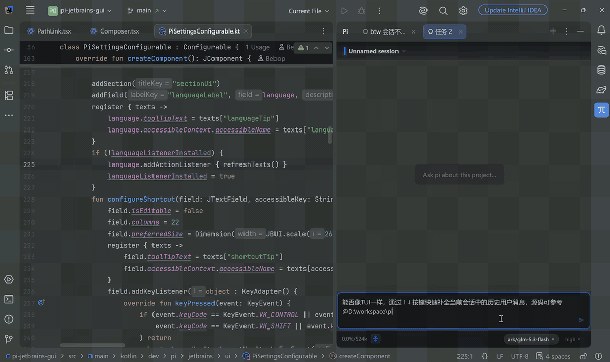
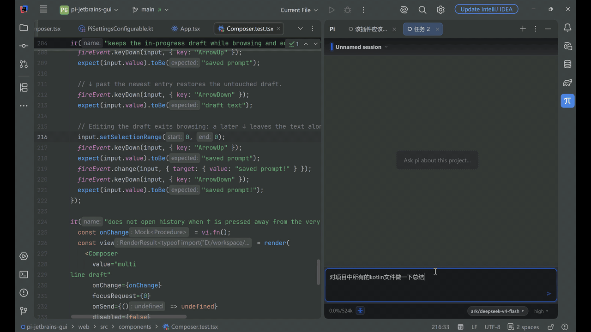
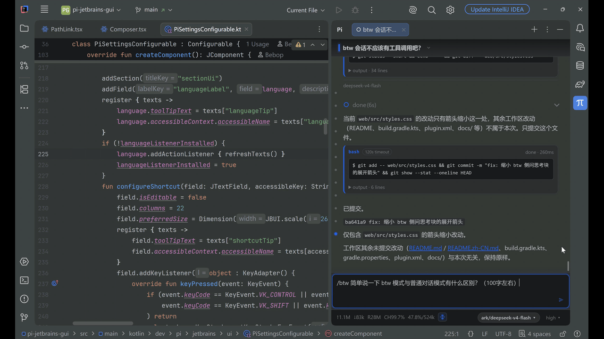

# Pi Coding Agent GUI

[](https://plugins.jetbrains.com/plugin/35678-pi-coding-agent-gui)
[](https://plugins.jetbrains.com/plugin/35678-pi-coding-agent-gui)
[](https://github.com/Cyber0xFE/pi-jetbrains-gui/stargazers)
[](LICENSE)
[](https://plugins.jetbrains.com/plugin/35678-pi-coding-agent-gui)
[](https://nodejs.org)

**把 [pi](https://github.com/earendil-works/pi) 搬进 JetBrains IDE——一个真正的聊天面板，不是又一个终端标签页。**

插件在你的本机启动 `pi --mode rpc` 子进程，把对话、工具调用、diff 和会话都呈现到 **Pi** 工具窗口里。支持 IntelliJ IDEA、PyCharm、WebStorm、GoLand、PhpStorm、CLion、Rider、RubyMine **2024.2 及以上**。会话沿用 pi 自己的 `~/.pi` 格式，模型、扩展和历史都还留在 CLI 那边。

> 🌏 本文档同时提供 [English (英文)](./README.md)。 · 📦 [从 JetBrains Marketplace 安装](https://plugins.jetbrains.com/plugin/35678-pi-coding-agent-gui)



## 为什么选这个插件

把 pi 接进 JetBrains IDE 的插件不止一个。区别在于：这个插件给的是完整对话面板，而且沿用 pi TUI 自己的交互方式。

| | Pi Coding Agent GUI | [Pi GUI](https://plugins.jetbrains.com/plugin/34238) | [Pi Agent Launcher](https://plugins.jetbrains.com/plugin/31737) | [Pi Terminal Bridge](https://plugins.jetbrains.com/plugin/34738) |
| --- | :---: | :---: | :---: | :---: |
| IDE 内聊天面板（不占用终端标签页） | ✅ | ✅ | — | — |
| 多标签页并行，每页一个独立 pi 进程 | ✅ | — | — | — |
| 流式回复期间可排队 steering / follow-up（`Enter` / `Alt+Enter`） | ✅ | — | — | — |
| `/btw` 旁路输出，不打断/污染主会话上下文 | ✅ | — | — | — |
| 会话树，任意用户消息都能 fork | ✅ | — | — | ✅ |
| 输入框内用 `!` / `!!` 直接跑命令 | ✅ | — | 终端内 | 终端内 |
| 会话内全文搜索（`Ctrl+F`，支持正则） | ✅ | — | — | — |
| 上下文用量、手动与自动压缩 | ✅ | ✅ | — | — |
| 输入框粘贴图片 | ✅ | ✅ | — | — |
| 编辑器选区、控制台输出可作上下文 | ✅ | ✅ | ✅ | ✅ |
| diff 卡片一键跳到编辑器对应行 | ✅ | ✅ | — | ✅ |
| 面板快捷键写入 IDE keymap | ✅ | — | ✅ | — |
| 中英双语界面（默认英文） | ✅ | ✅ | — | — |

<sub>`—` 表示该插件在自己的 Marketplace 描述里没提这项能力（2026-11 核对）。本插件默认英文界面，可在 `设置 | 工具 | Pi` 切到中文。</sub>

## 功能

- 在 IDE 里直接对话，回复流式输出
- 顶部可开多个任务标签页，每页独立 pi 进程，多个任务能同时跑
- 文件读取、代码编辑、终端命令等工具调用都有对应卡片
- 点 diff 卡片跳到编辑器里的对应位置
- 会话自动保存，IDE 重启后接着用
- 编辑器里选中的代码自动带上作为上下文
- 跟随 IDE 明暗主题
- 设置里能配 Node.js 路径、网络代理、日志目录、完成提示音、聊天背景图，以及界面语言（中文 / English）
- 页脚弹出小窗切换模型和思考级别，查看上下文用量和 token 统计；模型弹窗支持搜索、按 provider 分组，也能新增、编辑和删除自定义模型（写入 `~/.pi/agent/models.json`，不动已有配置）
- 新建、切换、重命名、删除、fork 会话，并在会话树里查看分支
- `/` 浏览 pi 命令，`@` 引用项目文件
- `/btw <问题>` 随时打开旁路输出（灵感来自 Claude Code）：主任务不打断，答案流式出现在可关闭的浮层里，也不会污染主会话上下文；只输入 `/btw` 就回看最近一次。浮层会显示连接和思考阶段，思考内容默认收起、点开才展开，想中断可以点停止，已生成的部分会保留
- 在输入框里像 pi TUI 一样跑 shell 命令：`! <命令>` 执行后输出留在 LLM 上下文，`!! <命令>` 则不进入上下文。命令跑完显示为终端风格卡片，运行中可以取消
- 手动压缩上下文、配置自动压缩、中止自动重试
- 支持 pi 扩展的弹窗、通知、状态文本和状态栏控件
- 文件、URL、终端输出、diff 位置都能直接跳进 IDE
- 粘贴图片随消息发送
- 可在设置里切换中文 / 英文界面（默认英文）

## 并行任务与队列

每个任务标签页有自己的 `pi` 进程，所以能同时跑多个任务，切走再切回也不会打断后台。pi 回复期间继续打字也行：`Enter` 把消息作为 **steering** 排队（当前工具调用结束后、下一次模型调用前送到），`Alt+Enter` 作为 **follow-up** 排队（这轮结束后再处理），语义和 pi TUI 一致。排队的消息会列在输入框上方，可以逐条编辑或删除。



## 使用 `/btw` 旁路输出

任务跑到一半想问点别的，用 `/btw` 就行，不用打断它。答案流式显示在可关闭的浮层里，也不会污染主会话上下文；只输入 `/btw` 则回看最近一次。



## 使用要求

- IntelliJ IDEA 2024.2 及以上（最低构建号 `242`）
- Java 21（只在构建插件时需要）
- Node.js `22.19.0` 及以上
- 已装好 pi，以下任一方式均可：

  ```bash
  # 官方安装脚本（macOS/Linux）
  curl -fsSL https://pi.dev/install.sh | sh

  # 或者用 npm 全局安装
  npm install -g @earendil-works/pi-coding-agent
  ```

插件按这个顺序找 pi：设置里配的入口 → 插件内置副本 → pi 安装脚本的托管目录（`~/.pi/agent/install`）→ npm 全局安装目录。
Node.js 优先用设置里指定的路径和系统 `PATH`，找不到就退回 pi 安装脚本自带的独立 Node（`~/.local/share/pi-node`）。启动失败时，先在设置里填一个可执行的 Node.js 路径，再确认 pi 命令本身能跑起来。

## 构建和运行

在项目根目录执行：

```bash
./gradlew buildPlugin
```

Windows PowerShell 用 `.\gradlew.bat buildPlugin`。

要起一个带插件的开发态 IDE：

```bash
./gradlew runIde
```

插件包输出在 `build/distributions/`。构建会自动装 webview 依赖，并把 React/TypeScript 前端打进插件资源。

Windows 上构建成功后，还会顺手给 `%APPDATA%/JetBrains/` 下已有的 IntelliJ IDEA、PyCharm 配置目录（2024.2+）排一次插件更新。走的是 IDE 自带的更新队列，其他待装插件不受影响，运行中占用的 JAR 也不会被覆盖。重启对应 IDE 时安装，构建不会替你关 IDE。日志里的 `Queued plugin update` 只表示已排队，正在运行的 IDE 还没生效。

只想打包、不想安装：加 `-PinstallLocalPlugin=false`。要指定本机目录，传 `-PlocalIdePluginDirs=目录1;目录2`（PowerShell 里把整个参数加引号）。这里填的是各 IDE 的 `plugins` 目录，并且要有对应的 `%LOCALAPPDATA%/JetBrains/<配置目录名>/.home` 记录。自定义缓存路径暂不支持。

## 使用

1. 装上构建出来的 ZIP，或者用 `runIde` 起开发态。
2. 打开右侧的 **Pi** 工具窗口。
3. 到 `Settings | Tools | Pi` 看一眼 Node.js 路径和日志目录。要用代理，就在“网络代理”里填完整地址（例如 `http://127.0.0.1:7890`）；插件只给 Pi 子进程注入 `HTTP_PROXY` 和 `HTTPS_PROXY`，不影响 IDE 和其他应用。改完代理会重启已启动标签页的 Pi 进程并恢复会话，正在跑的任务会中断；还没启动的标签页下次启动时才用新设置。留空就不覆盖从 IDE 继承的代理变量。
4. 在输入框发消息；或者在编辑器里选中文本，通过控制台右键菜单发给 Pi。
5. 点顶部的 **＋** 新建任务标签页。切标签页不打断后台任务；关掉标签页会结束它的进程，任务正在跑时会先确认。历史会话还能从会话列表恢复。控制台里的“发送到 Pi”发到当前选中的标签页。

会话列表能新建、切换、重命名、删除、fork。要打开的会话已经在别的标签页里开着，会直接跳过去，不会加载两份。
删除当前会话前，插件会先切到另一个会话，免得 pi 继续往即将删掉的文件里写。点删除图标会先在原地变成红色的“确认删除”，再点一次才真删；鼠标移开、改筛选词、选别的行、列表刷新都会取消这个待确认状态。
页脚的模型和思考级别入口会在上方弹出小面板（点外面或按 `Esc` 关闭）。模型面板按 provider 分组，能搜索、能用键盘挪，悬停的行才出现 **Set as default**；底部的 **Add model** 打开模型表单，把自定义 provider / 模型追加到 `~/.pi/agent/models.json`——已有 provider 只往后追加 `models`，`apiKey`、`baseUrl` 这些字段不会被动，重复的模型 id 会被拒绝。提供商输入框会列出你已有的 provider 供选择，也可以照旧输入新名字；上下文窗口和最大输出词元支持 `128k`、`8k` 这类 k 简写。来自 `models.json` 的模型算作自定义模型：悬停该行会出现铅笔和垃圾桶，铅笔打开同一张表单并预填已知字段（provider 和模型 ID 锁定），保存就地改写这一条，其它 provider 字段和已有 API 密钥保持不变（密钥输入留空即沿用原值）；垃圾桶点击后原地变成红色 **确认删除**，再点一次才真删。保存或删除后 pi 自动重启读取变更；pi 正在流式输出时插件会说明，变更在下次重启后生效。

在会话区按 `Ctrl+F` 打开搜索栏，能在用户消息和助手回复里找关键字，可以切区分大小写、全字匹配、正则；`Enter` / `Shift+Enter` 跳到下一个 / 上一个，`Esc` 或关闭按钮退出，命中所在的消息会高亮。

pi 回复途中也能继续打字：`Enter` 作为 **steering** 排队（pi 在当前工具调用结束、下一次模型调用前收到），`Alt+Enter` 作为 **follow-up** 排队（这轮结束后处理），和 pi TUI 一样。排队的消息列在输入框上方，等 pi 取走。
点列表上的 **Edit**（或者在输入框里按 `Alt+Up`）可以像 pi TUI 的 dequeue 那样逐条改：每条单独开一个编辑器，也能单独删。**Send all** 会重新入队——第一条起一轮，其余等 pi 进入流式后按原来的 steering / follow-up 类型回到各自队列，不会被并进同一轮。**Cancel** 还原未改的队列。
停止运行等同于 pi TUI 的 `Esc`：待发的 steering / follow-up 会先清空并交回编辑列表，然后才发中止请求。所以停下来不会悄悄丢消息（否则 pi 在 abort 之后还会继续 drain 队列）。

### 设置和快捷键

`Settings | Tools | Pi` 里能配界面语言（中文 / English）、Node.js 路径、网络代理、聊天字号（10–32px）、滚轮灵敏度（作用于聊天记录和选择器列表，默认速度的 25–400%）、主题色（Pi 聊天界面的强调色，用户消息气泡等强调元素跟着变，留空则跟随 IDE 主题）、背景图（PNG/JPG/GIF/WebP/BMP，显示在聊天记录后面，透明度设置类似 IDE 的编辑器背景图，4 MB 以内的文件会被编码后传进 WebView 并立即生效）、诊断日志目录、完成提示音，以及所有 Pi 面板快捷键。改完语言，已打开的聊天标签页立即更新。

| 操作 | 默认快捷键 |
| --- | --- |
| 打开 Pi 工具窗口 | `Ctrl+Alt+K` |
| 新建标签页 | `Ctrl+Shift+O` |
| 关闭标签页 | `Ctrl+W` |
| 上一个 / 下一个标签页 | `Ctrl+PageUp` / `Ctrl+PageDown` |
| 跳到最新 / 第一条消息 | `Ctrl+End` / `Ctrl+Home` |
| 上一条 / 下一条用户消息 | `Ctrl+↑` / `Ctrl+↓` |

快捷键写进当前 IDE keymap；当前 keymap 只读的话，插件会建一个叫 `Pi JetBrains GUI` 的派生 keymap。代理设置只给 Pi 子进程注入 `HTTP_PROXY` 和 `HTTPS_PROXY`，不改 IDE 和其他进程的环境变量。

### 故障排查

- pi 起不来：确认 Node.js 是 `22.19.0` 以上，再看设置里的 Node.js 路径；用 npm 装的，必要时重跑 `npm install -g @earendil-works/pi-coding-agent`。用 nvm 的人要在 IDE 实际使用的那个 Node 版本下装 pi，然后完全重启 IDE 让 PATH 生效。
- 消息或工具输出不对：在设置里指定诊断日志目录，复现后把日志和 IDE 版本一起附上。
- 改过代理或 Node.js 设置：已启动的标签页会重启 Pi 进程并恢复会话，正在跑的任务会中断。
- WebView 一片空白：跑 `./gradlew buildPlugin`（Windows 用 `gradlew.bat buildPlugin`）重新生成内置前端资源，并确认目标 IDE 支持 JCEF。

## 开发

前端在 `web/src`，Kotlin 插件代码在 `src/main/kotlin`。

```bash
cd web
npm ci
npm run typecheck
npm test
npm run build
```

RPC 协议见 `rpc-schema.json`。
改完前端，在 `web` 目录跑 `npm run typecheck && npm test`；插件产物的最终验证以根目录的 `buildPlugin` 为准。RPC 协议快照由 `rpc-schema.json` 固定，升级 pi 后先跑 `dumpRpcSchema`，看协议有没有漂移。

## 许可证和反馈

采用 [MIT 许可证](LICENSE)。内置的第三方组件及其许可证列在 [THIRD_PARTY_NOTICES.md](THIRD_PARTY_NOTICES.md)。

项目地址：[Cyber0xFE/pi-jetbrains-gui](https://github.com/Cyber0xFE/pi-jetbrains-gui)
